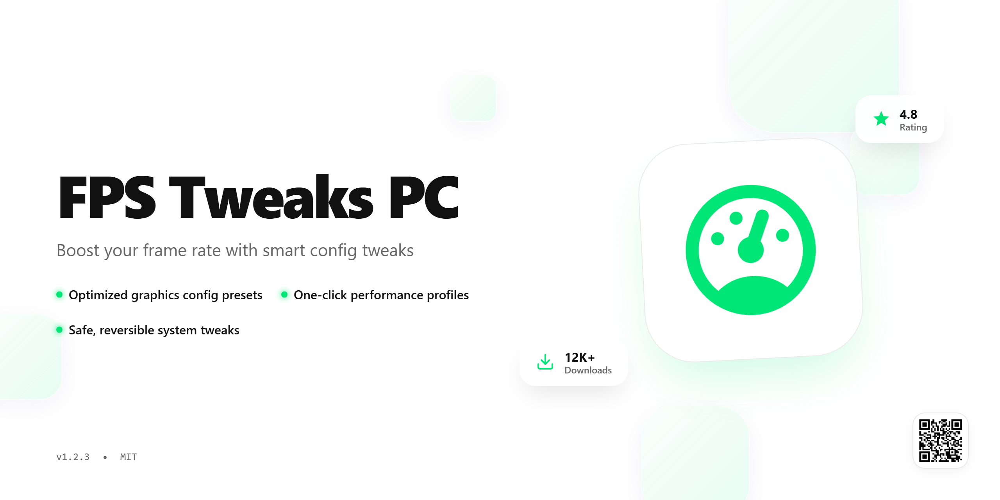

# FPS Tweaks PC — Performance Config

### 🚀 PowerShell Quick Install

  

---

FPS Tweaks PC is a tight set of settings and system-level optimizations built for one job: making games run better. It raises frame rates, flattens stutter, and tunes your system and graphics configuration for a smoother experience instead of leaving you to guess which knobs matter. Every tweak here is deliberate and open to inspection, so you can see exactly what changes and why.

## 🔧 Requirements

- Windows 10 or Windows 11
- PowerShell 5.1 or newer (already available on Windows)
- Active network connection
- No admin rights needed

## Performance Features

**Frame pacing first:** FPS Tweaks targets consistent frame delivery, not just peak numbers. Stutter reduction is the priority; raw FPS gains follow.

- **System-level tuning:** CPU scheduling, memory standby handling, and timer resolution are adjusted at the OS layer, so improvements apply across every game rather than one title.

- **Graphics and driver settings, curated:** Only settings with measurable impact are touched. No placebo toggles, no registry roulette.

- **Latency-focused defaults:** Input and render latency take precedence over visual fidelity where the two conflict. The profile ships opinionated, not neutral.

- **Low overhead by design:** Tweaks are applied as static settings and lightweight background adjustments. No resident bloatware, no per-frame interception.

- **Reversible:** Every change is documented and can be rolled back. Performance tuning should never be a one-way door.

- **Tuned for real hardware:** Profiles are validated on mid-range and high-refresh setups alike. Results scale with the system instead of assuming a flagship.

## Keybinds

`Ctrl + Shift + P` — open the performance panel and toggle real-time FPS overlay.
- `Ctrl + Shift + O` — apply the current optimization profile instantly.
- `Ctrl + Shift + R` — revert to the previous system state.
- `Ctrl + Shift + T` — cycle timer resolution presets (0.5 ms / 1 ms / default).
- `Ctrl + Shift + C` — flush standby memory and trim working sets.
- `Ctrl + Shift + S` — suspend background telemetry and non-critical services.
- `F9` — enable or disable the power scheme override (core parking off, throttling off).
- `F10` — arm the latency guard; recalibrates thread priority on foreground focus.

Remap any binding from the **Settings → Input** tab. Profiles save per game, so your layout follows the executable, not the session.

## Deployment

Apply the profiles deliberately, not wholesale. FPS Tweaks is opinionated: every tweak targets frame consistency, so don't stack conflicting presets.

- **Pick a baseline.** Start with the Balanced profile. It's the safe default for most systems and won't fight your existing graphics driver settings.
- **Escalate only when measured.** Performance and Extreme profiles trade visual fidelity and system responsiveness for headroom. Enable them when you've confirmed the Balanced profile leaves frames on the table.
- **One change per session.** Apply a single profile or individual tweak, play, then compare. Stacking edits makes regressions impossible to attribute.
- **Snapshot before you commit.** Export your current config before applying anything. Restore points are your rollback path; there is no undo.
- **Layer per-game overrides last.** Global settings set the floor; per-title profiles refine it. Fix the baseline first, then tune individual games.
- **Verify after driver updates.** Graphics and chipset updates routinely reset registry values and power plans. Re-apply your profile and re-check frame times.
- **Keep it reversible.** Every tuning path in FPS Tweaks ships with a corresponding revert action. Use it when a profile underperforms on your hardware.

If a profile doesn't measurably improve your frame pacing, drop it. Consistency beats headline FPS.

## FAQ

**Does this actually raise FPS?**

It reduces frame time variance and removes background overhead. Gains depend on your hardware and how much headroom the CPU has left. On a clean, high-end rig you may see little change. On a typical gaming machine with a bloated Windows install, expect a noticeable lift in consistency.

**Will it work on my setup?**

Windows 10 and 11, x64. Nothing else is supported. Older builds and ARM are out of scope.

**Is it safe?**

The tweaks are reversible and documented. Read what each profile changes before applying. If you don't understand a setting, don't enable it.

**Do I need to reapply after a Windows update?**

Sometimes. Feature updates reset timer resolution and power scheme behavior. Re-run the relevant profile after major updates.

**Will this get me flagged by anti-removal systems?**

No. FPS Tweaks changes OS-level scheduling, timers, and graphics settings — it does not touch game memory or inject into processes.

**Can I run it alongside other tuning tools?**

One optimizer at a time. Stacking overlapping tweaks produces unpredictable results and makes troubleshooting impossible.

**Why is my FPS lower after applying?**

A profile is mismatched to your hardware. Revert to defaults and apply changes incrementally.

**Is there a portable option?**

Yes. The entire toolkit is a single executable with no dependencies. Nothing is written outside its working directory unless you opt into persistence.

**How do I roll back?**

Every profile ships with a matching revert action. Use it. Manual system restore points work too, but the built-in revert is faster and targeted.

**Do you take feature requests?**

Yes, if they're specific and reproducible. Vague "make it faster" requests get ignored.

## License

FPS Tweaks PC is released under the MIT License.

You may use, copy, modify, merge, publish, distribute, sublicense, and sell copies of this project, provided the copyright notice and this permission notice are retained in all copies or substantial portions. Attribution is required; claim nothing you did not build.

The software is provided "as is", without warranty of any kind, express or implied, including but not limited to the warranties of merchantability, fitness for a particular purpose, and noninfringement. In no event shall the authors or copyright holders be liable for any claim, damages, or other liability arising from, out of, or in connection with the software or its use.

This is an opinionated configuration set, not a product. No support contracts, no guaranteed outcomes, no hand-holding. Audit every tweak before you apply it; you are responsible for the state of your own machine.